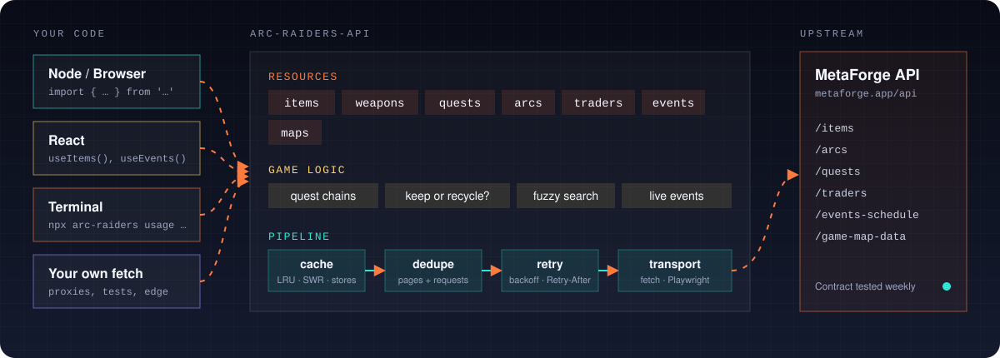

<div align="center">

<a href="https://github.com/justinjd00/arc-raiders-wrapper"></a>

<p>
<a href="https://www.npmjs.com/package/@justinjd00/arc-raiders-api"></a> <a href="https://www.npmjs.com/package/@justinjd00/arc-raiders-api"></a> <a href="https://www.npmjs.com/package/@justinjd00/arc-raiders-api"></a> <a href="https://www.npmjs.com/package/@justinjd00/arc-raiders-api"></a> <a href="https://www.npmjs.com/package/@justinjd00/arc-raiders-api"></a>
<br>
<a href="https://github.com/justinjd00/arc-raiders-wrapper/actions/workflows/ci.yml"></a> <a href="https://github.com/justinjd00/arc-raiders-wrapper/actions/workflows/contract.yml"></a> <a href="https://www.npmjs.com/package/@justinjd00/arc-raiders-api#provenance"></a> <a href="https://www.npmjs.com/package/@justinjd00/arc-raiders-api"></a> <a href="https://www.npmjs.com/package/@justinjd00/arc-raiders-api?activeTab=dependencies"></a> <a href="https://github.com/justinjd00/arc-raiders-wrapper/blob/main/LICENSE"></a>
<br>
<a href="https://github.com/justinjd00/arc-raiders-wrapper/stargazers"></a> <a href="https://github.com/justinjd00/arc-raiders-wrapper/releases"></a> <a href="https://github.com/justinjd00/arc-raiders-wrapper/commits/main"></a> <a href="https://github.com/justinjd00/arc-raiders-wrapper/issues"></a>
</p>

<p>
<a href="#quick-start"><b>Quick start</b></a> &nbsp;·&nbsp;
<a href="#api"><b>API</b></a> &nbsp;·&nbsp;
<a href="#react"><b>React</b></a> &nbsp;·&nbsp;
<a href="#cli"><b>CLI</b></a> &nbsp;·&nbsp;
<a href="#migrating-from-v1"><b>Migrating from v1</b></a> &nbsp;·&nbsp;
<a href="CHANGELOG.md"><b>Changelog</b></a>
</p>

</div>

Type-safe TypeScript client for the [MetaForge ARC Raiders API](https://metaforge.app/arc-raiders/api). Items, weapons, quests, ARCs, traders, Ermal, the live event schedule and map markers, plus the things you actually want to build on top of them: quest chains, "keep or recycle?" lookups, typo tolerant search, React hooks and a CLI.

```ts
import { createArcRaidersClient } from '@justinjd00/arc-raiders-api';

const arc = createArcRaidersClient();

await arc.items.all({ rarity: 'legendary' }); // every legendary, all pages
await arc.events.active(); // what is running right now
await arc.quests.chain('a-bad-feeling'); // every prerequisite, in play order
await arc.itemUsage('matriarch-reactor'); // { keep: true, acceptedByErmal: [...] }
await arc.search('ferro 2'); // finds "Ferro II"
```

## Live from MetaForge

These counters are pulled straight from the MetaForge API (refreshed hourly), the same data this package gives you.

<p align="center">
<a href="https://metaforge.app/arc-raiders"></a> <a href="https://metaforge.app/arc-raiders"></a> <a href="https://metaforge.app/arc-raiders"></a> <a href="https://metaforge.app/arc-raiders"></a>
</p>

## Highlights

<table>
<tr>
<td width="33%" valign="top">

### 🧩 Zero dependencies

Built on standard `fetch`. Runs on Node 20+ and in modern browsers. ESM and CommonJS, tree-shakeable, signed with npm provenance.

</td>
<td width="33%" valign="top">

### 🎯 Typed from real data

Every type is modeled on what MetaForge returns today. Known enums stay open, so a new rarity never breaks your build.

</td>
<td width="33%" valign="top">

### 🛡️ Resilient by default

Retries with backoff and jitter, `Retry-After`, timeouts, `AbortSignal`, request de-duplication and typed error codes.

</td>
</tr>
<tr>
<td valign="top">

### ⚡ Smart caching

LRU cache with per resource TTLs, stale-while-revalidate and pluggable stores like Redis or localStorage.

</td>
<td valign="top">

### 🗺️ Game logic built in

Quest chains in play order, "what can I do next", shopping lists, keep-or-recycle, live events, stat rankings, value per weight.

</td>
<td valign="top">

### 🔎 Fuzzy search

Offline, typo tolerant search across items, quests and ARCs. `"ferro 2"` finds Ferro II, `"matriach"` finds the Matriarch Reactor.

</td>
</tr>
<tr>
<td valign="top">

### ⚛️ React hooks

Shared client and cache, abort on unmount, a live event board hook and debounced search.

</td>
<td valign="top">

### 💻 CLI

`npx arc-raiders` for quick lookups in the terminal, table or JSON output and a disk cache.

</td>
<td valign="top">

### 📡 Contract tested

Checked against the live API every week. When MetaForge changes something, it shows up as an issue here, not as a bug in your app.

</td>
</tr>
</table>

## How it works

<p align="center">

</p>

The quirks of the API are handled in the pipeline: MetaForge sorts paginated results non-deterministically, so pages are de-duplicated by id. Filters are case-sensitive upstream and accept only one value, the client normalizes and filters locally where needed. The map endpoint lives outside `/arc-raiders`, quest lookups 404 instead of returning empty, all of that is hidden behind one consistent API.

## Install

```bash
npm install @justinjd00/arc-raiders-api
```

`pnpm add`, `yarn add` and `bun add` work the same. React and Playwright are optional peer dependencies, only install them if you use `/react` or `/browser`.

## Quick start

```ts
import { createArcRaidersClient, isArcRaidersError, rankByStat } from '@justinjd00/arc-raiders-api';

const arc = createArcRaidersClient();

try {
  const shotguns = await arc.weapons.all({ weaponClass: 'Shotgun' });
  for (const { item, value } of rankByStat(shotguns, 'damage', { limit: 3 })) {
    console.log(`${item.name}: ${value} damage`);
  }

  for (const event of await arc.events.active()) {
    console.log(`Live: ${event.name} on ${event.map}`);
  }
} catch (error) {
  if (isArcRaidersError(error)) console.error(error.code, error.message);
  else throw error;
}
```

More in [`examples/`](examples): a quest planner, a React event board and the browser transport.

## API

### Client options

```ts
const arc = createArcRaidersClient({
  timeout: 15_000, // per attempt, ms
  retry: { retries: 2, minDelay: 300, maxDelay: 8_000 }, // or false
  cache: { ttl: { traders: 60_000 }, staleWhileRevalidate: 5 * 60_000 }, // or false
  hooks: { onRetry: (e) => console.warn('retrying', e.url, e.error.code) },
  userAgent: 'my-app/1.0', // sent from server runtimes, default identifies this package
  fetch: customFetch, // proxies, tests, the Playwright transport
  headers: { 'X-Trace': '1' },
});
```

All defaults are sensible, `createArcRaidersClient()` is enough for most apps.

### Resources

Every list resource has the same shape: `all()` returns everything, `iterate()` streams it, `list()` returns a single raw page, `get(id)` returns one entry or `undefined`. Every method takes an optional last argument `{ signal, fresh }` to abort or to skip the cache.

| Resource      | Methods                                                                                                   |
| ------------- | --------------------------------------------------------------------------------------------------------- |
| `arc.items`   | `all(filter)`, `iterate(filter)`, `list(filter, { page, pageSize })`, `get(id)`                           |
| `arc.weapons` | `all({ weaponClass, rarity, search })`, `get(id)`                                                         |
| `arc.quests`  | `all()`, `iterate()`, `list()`, `get(id)`, `graph()`, `chain(id)`, `available(done)`, `shoppingList(ids)` |
| `arc.arcs`    | `all({ includeLoot })`, `iterate()`, `list()`, `get(id, { includeLoot })`                                 |
| `arc.traders` | `getAll()`, `inventories()`, `get(name)`, `ermal()`, `whoSells(itemId)`                                   |
| `arc.events`  | `schedule()`, `active(query)`, `upcoming(query)`, `next(name)`                                            |
| `arc.maps`    | `list()`, `markers(mapId, { category, subcategory })`                                                     |
| `arc`         | `search(query, { in, limit })`, `itemUsage(itemId)`, `clearCache()`                                       |

### Items and weapons

```ts
await arc.items.all({ rarity: 'epic' }); // case does not matter
await arc.items.all({ rarity: ['Epic', 'Legendary'] }); // several values work too
await arc.items.all({ itemType: 'quick_use', search: 'grenade' });
await arc.items.get('ferro-i'); // Item | undefined

await arc.weapons.all({ weaponClass: ['SMG', 'Pistol'], rarity: 'rare' });

// Stream instead of loading everything at once
for await (const item of arc.items.iterate({ itemType: 'Blueprint' })) {
  console.log(item.name);
}
```

Items carry the full `stat_block` (damage, fire rate, range, weight, slots and ~80 more), `workbench`, `loadout_slots`, `locations`, guide links and more. See [`types.ts`](src/arc-raiders/types.ts).

### Quests

```ts
const quest = await arc.quests.get('a-bad-feeling'); // Quest | undefined

// Everything you need to do first, in a valid order, ending with the quest itself
const path = await arc.quests.chain('a-bad-feeling');

// What can I pick up now?
const next = await arc.quests.available(['picking-up-the-pieces', 'clearer-skies']);

// What should I stash for those?
const list = await arc.quests.shoppingList(next.map((q) => q.id));
// [{ item: { name: 'Wires', ... }, quantity: 6, neededFor: [{ questName: 'Trash Into Treasure', ... }] }]

const graph = await arc.quests.graph();
graph.unlocks('clearer-skies'); // quest ids that require it
```

The graph is built from `manifest.prerequisites`, survives cycles and missing quests in community data, and has no recursion limit.

### Keep or recycle?

```ts
const usage = await arc.itemUsage('matriarch-reactor');
usage.keep; // true: something still wants it
usage.requiredBy; // quests that need it, with quantity
usage.acceptedByErmal; // Ermal offers and services that take it
usage.droppedBy; // ARCs that drop it
usage.soldBy; // traders selling it, with price
usage.rewardedBy; // quests that give it out
```

### ARCs, traders and Ermal

```ts
const bastion = await arc.arcs.get('bastion', { includeLoot: true });
bastion?.loot?.map((l) => l.item.name);

await arc.traders.get('celeste'); // inventory, name is case-insensitive
await arc.traders.whoSells('battery'); // cheapest first
const ermal = await arc.traders.ermal(); // rotating offers and permanent services
```

### Events

```ts
await arc.events.active(); // running now, ending soonest first
await arc.events.upcoming({ map: 'blue-gate', within: 2 * 3_600_000, limit: 5 });
await arc.events.next('Night Raid'); // next (or current) run
```

`map` accepts the display name (`"Blue Gate"`) or the map id (`"blue-gate"`). Pass `at` to evaluate any point in time.

### Maps

```ts
arc.maps.list(); // the 7 maps, no request needed
const crates = await arc.maps.markers('riven-tides', { category: 'containers' });
```

Map ids: `dam`, `spaceport`, `buried-city`, `blue-gate`, `stella-montis`, `riven-tides`, `pendola-pass`.

### Search

```ts
const hits = await arc.search('matriach reactor', { limit: 5 });
// [{ id: 'matriarch-reactor', name: 'Matriarch Reactor', score: 0.78, value: { type: 'item', data: Item } }, ...]

await arc.search('bastoin', { in: ['arcs'] });
```

Runs locally on cached data. Forgives typos and swapped letters, matches prefixes and understands `2` as `II`. The index is built once per client.

### Errors

Every request problem is an `ArcRaidersError`:

| `code`             | When                                                         |
| ------------------ | ------------------------------------------------------------ |
| `NOT_FOUND`        | 404                                                          |
| `RATE_LIMITED`     | 429 after all retries                                        |
| `BLOCKED`          | Cloudflare 403, see [browser transport](#cloudflare)         |
| `HTTP_ERROR`       | any other non 2xx                                            |
| `TIMEOUT`          | took longer than `timeout`                                   |
| `ABORTED`          | your `signal` fired                                          |
| `NETWORK_ERROR`    | DNS, TLS, connection reset                                   |
| `INVALID_RESPONSE` | the body was not the shape we expect, the API likely changed |

Errors also carry `status`, `url`, `body`, `retryable` and `attempts`. Use `isArcRaidersError(e)` as a type guard, it also works across duplicated package copies.

### Caching

On by default, in memory. TTLs follow how often the data changes: items, ARCs and quests 30 minutes, maps 1 hour, traders 5 minutes, events 1 minute.

```ts
// Serve stale data instantly while refreshing in the background
createArcRaidersClient({ cache: { staleWhileRevalidate: 10 * 60_000 } });

// Bring your own store, sync or async
createArcRaidersClient({
  cache: {
    store: {
      get: (key) => redis.get(key).then((v) => (v ? JSON.parse(v) : undefined)),
      set: (key, entry) => redis.set(key, JSON.stringify(entry)),
      delete: (key) => redis.del(key),
      clear: () => redis.flushdb(),
    },
  },
});

await arc.items.all({}, { fresh: true }); // skip the cache once
await arc.clearCache();
```

Concurrent identical requests share one network call, cached or not (calls with their own `signal` stay separate so aborting one never cancels another).

### Helpers

Pure functions, usable without the client:

```ts
import {
  buildQuestGraph,
  questShoppingList,
  findItemUsage,
  activeEvents,
  upcomingEvents,
  createSearchIndex,
  rankByStat,
  valuePerWeight,
  statSummary,
  rarityDistribution,
  toCSV,
} from '@justinjd00/arc-raiders-api';

valuePerWeight(items, { limit: 10 }); // best coins per weight, what to carry out
statSummary(weapons, 'fireRate'); // { count, min, max, mean, median, sum }
toCSV(items, { columns: ['id', 'name', 'rarity'], delimiter: ';' }); // safe against CSV injection
```

## React

```tsx
import {
  ArcRaidersProvider,
  useEvents,
  useItems,
  useSearch,
} from '@justinjd00/arc-raiders-api/react';

function LiveEvents() {
  const { active, upcoming, loading } = useEvents({ upcomingLimit: 5 });
  if (loading) return <p>Loading...</p>;
  return (
    <ul>
      {active.map((e) => (
        <li key={e.name + e.map}>
          {e.name} on {e.map}
        </li>
      ))}
    </ul>
  );
}

export const App = () => (
  <ArcRaidersProvider options={{ cache: { staleWhileRevalidate: 300_000 } }}>
    <LiveEvents />
  </ArcRaidersProvider>
);
```

Hooks: `useItems`, `useItem`, `useWeapons`, `useQuests`, `useArcs`, `useTraders`, `useEvents`, `useSearch` (debounced) and the generic `useArcRaidersQuery(key, fetcher)`. Each returns `{ data, error, loading, refetch }`. Requests are aborted on unmount, results from outdated inputs are dropped, and all components share one client and cache through the provider. Works without a provider too.

## CLI

<p align="center">

</p>

<p align="center"><sub>Real output, recorded against the live API.</sub></p>

```bash
npx @justinjd00/arc-raiders-api events
```

Or install globally and use `arc-raiders`:

```bash
arc-raiders items --rarity legendary --type trinket
arc-raiders weapons --class SMG,Pistol
arc-raiders item ferro-i               # details with all stats
arc-raiders quest a-bad-feeling --chain
arc-raiders usage matriarch-reactor    # KEEP or safe to recycle
arc-raiders search "venator 2"
arc-raiders rank damage --class Shotgun
arc-raiders value --limit 10           # best value per weight
arc-raiders events --map dam
arc-raiders ermal
arc-raiders export items --out items.csv --delimiter ";"
arc-raiders stats
```

Add `--json` for raw output and `--no-cache` to skip the disk cache. `arc-raiders --help` lists everything.

<a id="cloudflare"></a>

## Cloudflare and the browser transport

MetaForge sits behind Cloudflare. Plain requests from Node, browsers and most HTTP clients go through fine, this package sends an identifiable User-Agent by default (some generic ones, like Python's `urllib`, get blocked). If your network still gets `BLOCKED` errors, route requests through a real browser:

```bash
npm install playwright && npx playwright install chromium
```

```ts
import { createBrowserClient } from '@justinjd00/arc-raiders-api/browser';

const arc = createBrowserClient({ headless: true });
try {
  console.log(await arc.arcs.all());
} finally {
  await arc.close();
}
```

It is the same client with the same API, caching and retries, only the transport differs. The browser starts lazily on the first request. For other setups, `createPlaywrightTransport()` gives you a plain `fetch` you can pass to any client.

## Migrating from v1

v1 targeted endpoints that MetaForge no longer serves (`/weapons`, `/armor`, `/maps`, `/items/:id`, ...), so most v1 calls fail today. v2 is a rewrite against the current API. The old methods still exist and are marked `@deprecated`, so existing code compiles and works while you migrate.

| v1                                         | v2                                                             |
| ------------------------------------------ | -------------------------------------------------------------- |
| `getItems(filter)` / `getAllItems()`       | `items.all(filter)`                                            |
| `getItemById(id)`                          | `items.get(id)` (returns `undefined` instead of throwing)      |
| `getWeapons()`                             | `weapons.all()`                                                |
| `getArmor()`                               | `items.all({ itemType: 'Shield' })`, there is no armor         |
| `getQuests()` / `getQuestById(id)`         | `quests.all()` / `quests.get(id)`                              |
| `getARCs()` / `getARCById(id)`             | `arcs.all()` / `arcs.get(id)`                                  |
| `getTraders()`                             | `traders.inventories()`                                        |
| `getMaps()` / `getMapData(name)`           | `maps.list()` / `maps.markers(mapId)`                          |
| `filter.type`                              | `filter.itemType`                                              |
| `ApiError`                                 | `ArcRaidersError` with `code`                                  |
| `exportToJSON(path)` / `exportToCSV(path)` | `toJSON()` / `toCSV()` return strings, or use the CLI `export` |
| React hooks from the main entry            | import from `@justinjd00/arc-raiders-api/react`                |
| `createBrowserClient` from the main entry  | import from `@justinjd00/arc-raiders-api/browser`              |

Field names changed with the API, e.g. `type` is now `item_type`, and quests use `required_items`, `rewards` and `manifest.objective_graph`. The old `baseURL` (`.../api/arc-raiders`) is still accepted.

## Data source and terms

All data comes from [MetaForge](https://metaforge.app/arc-raiders), collected by their team and community, not by Embark Studios. Their terms ask public projects to credit them with a link, and paid or monetized projects to contact them on Discord first. The package exports a ready-made credit line:

```ts
import { ATTRIBUTION } from '@justinjd00/arc-raiders-api';
// ATTRIBUTION.text, ATTRIBUTION.url, ATTRIBUTION.html
```

This project is not affiliated with MetaForge or Embark Studios. ARC Raiders is a trademark of Embark Studios.

## Contributing

See [CONTRIBUTING.md](CONTRIBUTING.md). `npm test` runs offline, `npm run test:contract` checks the live API. Found a quirk in the API or a missing field? [Open an issue](https://github.com/justinjd00/arc-raiders-wrapper/issues/new).

## Star history

<a href="https://star-history.com/#justinjd00/arc-raiders-wrapper&Date">
  <picture>
    <source media="(prefers-color-scheme: dark)" srcset="https://api.star-history.com/svg?repos=justinjd00/arc-raiders-wrapper&type=Date&theme=dark">
    
  </picture>
</a>

## License

[MIT](LICENSE) · Made by [Justin Dewitz](https://github.com/justinjd00) · Game data by [MetaForge](https://metaforge.app/arc-raiders)

<p align="center">

</p>
